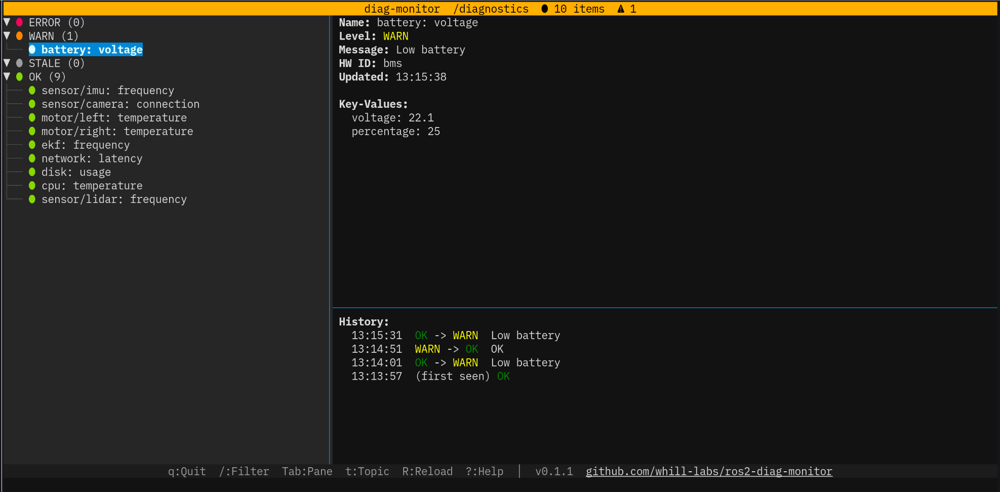

# ros2-diag-monitor

A terminal UI for monitoring ROS2 diagnostics over SSH.



## Features

- Real-time diagnostics monitoring with lazygit-style 3-pane layout
- Header color changes based on worst diagnostic level (green=OK, yellow=WARN, red=ERROR)
- Items grouped by level (ERROR / WARN / STALE / OK)
- Detailed view with key-value pairs
- Status change history tracking
- Optional JSONL log file output
- Topic switching between `/diagnostics` and `/diagnostics_agg`
- Reload subscription with `R` key (useful after network recovery)
- Incremental name filter with `/` key (case-insensitive substring match)
- Keybinding help modal with `?` key

## Requirements

- Python >= 3.10 (must match your ROS2 distribution's Python)
- ROS2 environment with `rclpy` available

## Install

This tool requires access to system-installed `rclpy`, so it needs `--system-site-packages`.

```bash
source /opt/ros/jazzy/setup.bash

# Recommended: pipx with system site-packages
pipx install --system-site-packages ros2-diag-monitor
```

> **Note:** `uv tool install` does not support `--system-site-packages` and cannot be used.

## Usage

```bash
source /opt/ros/jazzy/setup.bash

# Monitor aggregated diagnostics (default)
diag-monitor

# Monitor /diagnostics
diag-monitor --topic /diagnostics

# Set the per-diagnostic freshness timeout (default: 3 seconds)
diag-monitor --stale-after 5

# Disable local expiry for diagnostics that only publish on changes
diag-monitor --stale-after 0

# Save status changes to file
diag-monitor --log-file diag.log
```

Silent diagnostics are shown as STALE using monotonic elapsed time. The last
reported level, message and values remain available; a new report restores the
published level. STALE contributes to the summary color and count. An empty
stream shows `Waiting for diagnostics`; a stopped stream keeps a visible age
warning. Local expiry does not change the publisher's status or level history.

## Key Bindings

| Key | Action |
|---|---|
| `j`/`k` or `Up`/`Down` | Navigate items |
| `Tab` | Switch pane focus |
| `t` | Toggle topic (`/diagnostics` <-> `/diagnostics_agg`) |
| `R` | Reload (re-subscribe and clear) |
| `/` | Filter by name |
| `q` | Quit |
| `?` | Help |

## Development

```bash
git clone https://github.com/whill-labs/ros2-diag-monitor.git
cd ros2-diag-monitor

# Create venv with the same Python version as ROS2 and system-site-packages enabled
source /opt/ros/jazzy/setup.bash
uv venv --python 3.12 --system-site-packages
uv sync

# Run tests
uv run pytest

# Run in development
uv run diag-monitor
```

## License

MIT License

(C) 2026 WHILL Inc.

